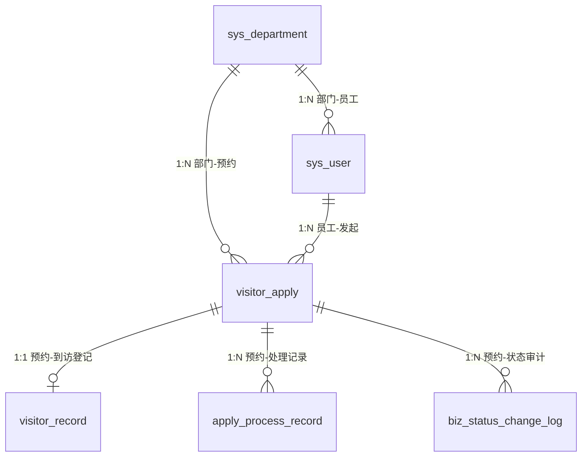

# G12 访客预约平台 · 数据库设计文档

> 负责人：B（后端）
> 事实源：本文档与 `database/schema.sql` 必须逐字一致。改表结构 = 先改 schema.sql，再改本文档，再通知 A/C。
> 数据库：MySQL 8.0　库名：`ctts_g12`　字符集：`utf8mb4`　排序：`utf8mb4_general_ci`　引擎：`InnoDB`

---

## 1. 设计约定

| 项 | 约定 |
|---|---|
| 表名前缀 | `sys_` 系统表、`visitor_` 业务表、`apply_`/`biz_` 过程与审计表 |
| 主键 | `id BIGINT UNSIGNED AUTO_INCREMENT`，全表统一 |
| 外键 | 物理外键，命名 `fk_<表>_<被引用表>`，默认 `ON DELETE RESTRICT ON UPDATE CASCADE` |
| 时间 | `create_time` 默认 `CURRENT_TIMESTAMP`；`update_time` 加 `ON UPDATE CURRENT_TIMESTAMP` |
| 状态字段 | `TINYINT`，不用 `ENUM`，避免改状态要 `ALTER TABLE` |
| 布尔语义 | `status TINYINT`，1 启用 / 0 停用，不用 `is_xxx` 命名 |
| 删除策略 | **不物理删除业务数据**。用户、部门"删除"= 置 `status=0`；预约单不删除 |
| 金额/时长 | 本系统无金额；时长由 `visitor_record` 两个时间戳相减得出，不冗余存 |
| 大小写 | 库名、表名、字段名全小写下划线；Java 侧驼峰自动映射 |

---

## 2. ER 关系图

**外键清单（6 条）**

| 外键 | 从表.字段 | 到表.字段 | 说明 |
|---|---|---|---|
| `fk_user_dept` | `sys_user.dept_id` | `sys_department.id` | 员工所属部门 |
| `fk_apply_dept` | `visitor_apply.dept_id` | `sys_department.id` | 被访部门，AUDITOR 审核范围依据 |
| `fk_apply_user` | `visitor_apply.create_by` | `sys_user.id` | 预约发起人 |
| `fk_record_apply` | `visitor_record.apply_id` | `visitor_apply.id` | 一条预约最多一条到访记录 |
| `fk_process_apply` | `apply_process_record.apply_id` | `visitor_apply.id` | 处理记录归属 |
| `fk_statuslog_apply` | `biz_status_change_log.apply_id` | `visitor_apply.id` | 状态审计归属 |

---

## 3. 表结构定义

### 3.1 `sys_department` 部门表

| 字段 | 类型 | 空 | 默认 | 说明 |
|---|---|---|---|---|
| `id` | BIGINT UNSIGNED | 否 | AUTO_INCREMENT | 主键 |
| `dept_code` | VARCHAR(32) | 否 | — | 部门编码，如 `D001` |
| `dept_name` | VARCHAR(64) | 否 | — | 部门名称 |
| `manager_name` | VARCHAR(32) | 是 | NULL | 部门负责人 |
| `phone` | VARCHAR(20) | 是 | NULL | 办公电话 |
| `status` | TINYINT | 否 | 1 | 1 启用 / 0 停用 |
| `create_time` | DATETIME | 否 | CURRENT_TIMESTAMP | 创建时间 |
| `update_time` | DATETIME | 否 | CURRENT_TIMESTAMP ON UPDATE | 更新时间 |

索引：`PRIMARY KEY(id)`、`UNIQUE uk_dept_code(dept_code)`、`UNIQUE uk_dept_name(dept_name)`

### 3.2 `sys_user` 用户表

| 字段 | 类型 | 空 | 默认 | 说明 |
|---|---|---|---|---|
| `id` | BIGINT UNSIGNED | 否 | AUTO_INCREMENT | 主键 |
| `username` | VARCHAR(32) | 否 | — | 登录名，唯一 |
| `password` | VARCHAR(100) | 否 | — | BCrypt 密文，**禁止存明文** |
| `real_name` | VARCHAR(32) | 否 | — | 真实姓名 |
| `phone` | VARCHAR(20) | 是 | NULL | 手机号 |
| `dept_id` | BIGINT UNSIGNED | 否 | — | 所属部门，外键 |
| `role` | VARCHAR(20) | 否 | — | `EMPLOYEE` / `AUDITOR` / `ADMIN` |
| `status` | TINYINT | 否 | 1 | 1 启用 / 0 停用（停用即不可登录） |
| `create_time` | DATETIME | 否 | CURRENT_TIMESTAMP | 创建时间 |
| `update_time` | DATETIME | 否 | CURRENT_TIMESTAMP ON UPDATE | 更新时间 |

索引：`PRIMARY KEY(id)`、`UNIQUE uk_username(username)`、`KEY idx_user_dept(dept_id)`、`KEY idx_user_role(role)`
外键：`fk_user_dept(dept_id) → sys_department(id)`

> `DELETE /users/{id}` 的实现是 `UPDATE sys_user SET status=0`，不是物理删除——外键会挡住物理删除，且审计要求保留历史。

### 3.3 `visitor_apply` 预约主单表

| 字段 | 类型 | 空 | 默认 | 说明 |
|---|---|---|---|---|
| `id` | BIGINT UNSIGNED | 否 | AUTO_INCREMENT | 主键 |
| `apply_no` | VARCHAR(32) | 否 | — | 预约单号 `AP` + yyyyMMdd + 6 位序号，唯一 |
| `visitor_name` | VARCHAR(32) | 否 | — | 访客姓名 |
| `visitor_phone` | VARCHAR(20) | 否 | — | 访客手机号 |
| `visitor_company` | VARCHAR(64) | 是 | NULL | 访客单位 |
| `dept_id` | BIGINT UNSIGNED | 否 | — | 被访部门，外键 |
| `host_name` | VARCHAR(32) | 是 | NULL | 被访人姓名 |
| `visit_reason` | VARCHAR(255) | 是 | NULL | 来访事由 |
| `visit_time` | DATETIME | 否 | — | 预计到访时间 |
| `leave_time` | DATETIME | 是 | NULL | 预计离开时间 |
| `verify_code` | VARCHAR(6) | 是 | NULL | 6 位核验码，状态 2 时生成 |
| `status` | TINYINT | 否 | 0 | 0 待审核 / 1 审核通过 / 2 待到访 / 3 已到访 / 4 已离开 / 9 驳回或取消 |
| `create_by` | BIGINT UNSIGNED | 否 | — | 预约发起人（员工），外键 |
| `create_time` | DATETIME | 否 | CURRENT_TIMESTAMP | 创建时间 |
| `update_time` | DATETIME | 否 | CURRENT_TIMESTAMP ON UPDATE | 更新时间 |

索引：
- `PRIMARY KEY(id)`
- `UNIQUE uk_apply_no(apply_no)`
- `KEY idx_apply_status(status)`
- `KEY idx_apply_dept_status(dept_id, status)`　← AUDITOR 查本部门待审核走这条
- `KEY idx_apply_create_by(create_by)`　← 员工查我的预约
- `KEY idx_apply_visit_time(visit_time)`　← 统计按日期分组

外键：`fk_apply_dept(dept_id) → sys_department(id)`、`fk_apply_user(create_by) → sys_user(id)`

> `status` 只允许通过 `ApplyStateService.transit()` 修改，**全项目禁止任何直接 `UPDATE visitor_apply SET status`**。

### 3.4 `visitor_record` 到访离场登记表

| 字段 | 类型 | 空 | 默认 | 说明 |
|---|---|---|---|---|
| `id` | BIGINT UNSIGNED | 否 | AUTO_INCREMENT | 主键 |
| `apply_id` | BIGINT UNSIGNED | 否 | — | 关联预约单，外键，**唯一** |
| `checkin_time` | DATETIME | 否 | — | 入场登记时间 |
| `checkout_time` | DATETIME | 是 | NULL | 离场登记时间，NULL 表示仍在场 |
| `checkin_by` | BIGINT UNSIGNED | 否 | — | 入场登记操作人（门卫/ADMIN） |
| `checkout_by` | BIGINT UNSIGNED | 是 | NULL | 离场登记操作人 |
| `gate` | VARCHAR(32) | 是 | NULL | 门岗/闸机标识，如 `东门-01` |
| `create_time` | DATETIME | 否 | CURRENT_TIMESTAMP | 创建时间 |
| `update_time` | DATETIME | 否 | CURRENT_TIMESTAMP ON UPDATE | 更新时间 |

索引：`PRIMARY KEY(id)`、`UNIQUE uk_record_apply(apply_id)`、`KEY idx_record_checkin(checkin_time)`

> 一条预约只能有一条到访记录：入场时 `INSERT`，离场时 `UPDATE checkout_time`。唯一键保证重复核验直接报错，而不是产生两条脏数据。

### 3.5 `apply_process_record` 业务操作处理记录表

| 字段 | 类型 | 空 | 默认 | 说明 |
|---|---|---|---|---|
| `id` | BIGINT UNSIGNED | 否 | AUTO_INCREMENT | 主键 |
| `apply_id` | BIGINT UNSIGNED | 否 | — | 关联预约单，外键 |
| `action` | VARCHAR(32) | 否 | — | `CREATE`/`APPROVE`/`REJECT`/`VERIFY_CODE`/`CHECKIN`/`CHECKOUT`/`CANCEL` |
| `operator_id` | BIGINT UNSIGNED | 否 | — | 操作人 ID |
| `operator_name` | VARCHAR(32) | 否 | — | 操作人姓名（冗余，防用户改名后无法追溯） |
| `operator_role` | VARCHAR(20) | 否 | — | 操作人角色，记录操作时的角色 |
| `remark` | VARCHAR(255) | 是 | NULL | 备注/驳回原因 |
| `create_time` | DATETIME | 否 | CURRENT_TIMESTAMP | 处理时间 |

索引：`PRIMARY KEY(id)`、`KEY idx_process_apply(apply_id)`、`KEY idx_process_action(action)`、`KEY idx_process_time(create_time)`

### 3.6 `biz_status_change_log` 状态变更审计日志表

| 字段 | 类型 | 空 | 默认 | 说明 |
|---|---|---|---|---|
| `id` | BIGINT UNSIGNED | 否 | AUTO_INCREMENT | 主键 |
| `apply_id` | BIGINT UNSIGNED | 否 | — | 关联预约单，外键 |
| `from_status` | TINYINT | 否 | — | 变更前状态 |
| `to_status` | TINYINT | 否 | — | 变更后状态 |
| `action` | VARCHAR(32) | 否 | — | 触发动作，与处理记录 `action` 对齐 |
| `operator_id` | BIGINT UNSIGNED | 否 | — | 操作人 ID |
| `operator_name` | VARCHAR(32) | 否 | — | 操作人姓名 |
| `remark` | VARCHAR(255) | 是 | NULL | 备注 |
| `create_time` | DATETIME | 否 | CURRENT_TIMESTAMP | 变更时间 |

索引：`PRIMARY KEY(id)`、`KEY idx_statuslog_apply(apply_id)`、`KEY idx_statuslog_time(create_time)`

> 这张表**只增不改不删**。任何状态变更必须在此留痕，否则视为 bug。

---

## 4. 数据字典

### 4.1 预约单状态 `visitor_apply.status`

| 值 | 名称 | 含义 | 触发动作 |
|---|---|---|---|
| 0 | 待审核 | 员工提交后 | `CREATE` |
| 1 | 审核通过 | 审核员通过，等待生成核验码 | `APPROVE` |
| 2 | 待到访 | 已生成核验码，等待访客到场 | `VERIFY_CODE` |
| 3 | 已到访 | 门卫核验码通过并登记入场 | `CHECKIN` |
| 4 | 已离开 | 离场登记完成 | `CHECKOUT` |
| 9 | 驳回/取消 | 异常终态 | `REJECT` / `CANCEL` |

**允许流转表**（不在表内的转移一律 `400 STATE_NOT_ALLOWED`）：

| from \ to | 1 | 2 | 3 | 4 | 9 |
|---|---|---|---|---|---|
| 0 待审核 | ✅ | — | — | — | ✅ |
| 1 审核通过 | — | ✅ | — | — | ✅ |
| 2 待到访 | — | — | ✅ | — | ✅（取消） |
| 3 已到访 | — | — | — | ✅ | — |
| 4 已离开 | — | — | — | — | — |
| 9 驳回/取消 | — | — | — | — | — |

> 表里 `2 → 9` 是「访客未按约到访，取消」的场景；`3 → 9`、`4 → 9` 不允许，人已经来了不能倒回去。

### 4.2 角色 `sys_user.role`

| 值 | 名称 | 权限边界 |
|---|---|---|
| `EMPLOYEE` | 员工 | 新建预约、查看本人预约、取消本人预约；不能审核、不能管人 |
| `AUDITOR` | 审核员 | 只看本部门预约、审核本部门预约、查本部门预约记录、**本部门预约的入离场核验（门岗）**；不能管用户/部门 |
| `ADMIN` | 管理员 | 全部权限：用户、部门、全部预约、门卫核验、全局统计、强制状态操作 |

### 4.3 动作码 `action`

| 值 | 含义 | 写处理记录 | 写状态审计 |
|---|---|---|---|
| `CREATE` | 提交预约 | ✅ | ✅（0←∅） |
| `APPROVE` | 审核通过 | ✅ | ✅（0→1） |
| `REJECT` | 驳回 | ✅ | ✅（0→9） |
| `VERIFY_CODE` | 生成核验码并流转 | ✅ | ✅（1→2） |
| `CHECKIN` | 入场核验 | ✅ | ✅（2→3） |
| `CHECKOUT` | 离场登记 | ✅ | ✅（3→4） |
| `CANCEL` | 取消预约 | ✅ | ✅（0/1/2→9） |

---

## 5. 关键约束与设计决策

1. **状态变更必须走事务三件套**：`UPDATE status` + `INSERT biz_status_change_log` + `INSERT apply_process_record`，同一个 `@Transactional` 内，任一失败整体回滚。
2. **核验码唯一性**：`verify_code` 只在状态 2 存在；生成时用数据库查重，6 位数字，碰撞就重试 3 次。不对 `verify_code` 建唯一索引——历史单里同一码可能被回收重用，且多张单可能同时处于状态 2 但码不能重复，实际由生成逻辑保证。
3. **部门停用不动历史**：`sys_department.status=0` 后，该部门的历史预约仍可查询，只是不能新建。
4. **用户停用即时生效**：`sys_user.status=0` 后登录返回 `401 USER_DISABLED`，已签发的 JWT 在拦截器里复查状态后失效。
5. **外键策略选 RESTRICT 而非 CASCADE**：预约单被删会连带丢掉审计日志，审计不允许 CASCADE。
6. **索引依据真实查询**：`idx_apply_dept_status` 服务审核员列表，`idx_apply_create_by` 服务"我的预约"，`idx_apply_visit_time` 服务趋势统计，没有为了好看乱加索引。
7. **时间统一 DATETIME**：不用 `TIMESTAMP`，避免 2038 问题与时区隐式转换；时区由容器 `TZ=Asia/Shanghai` 统一。

---

## 6. 与种子数据的关系

`database/seed.sql` 必须满足：

- 每张主表 ≥ 10 条：`sys_department` 10 条、`sys_user` 12 条（含 3 角色）、`visitor_apply` 14 条、`visitor_record` 10 条、`apply_process_record` 52 条、`biz_status_change_log` 52 条。
- `visitor_apply` 覆盖 0/1/2/3/4/9 全部状态，且每种状态 ≥ 1 条；因到访记录与预约一对一，状态 3/4 合计必须 ≥ 10 条，故预约取 14 条（4:4 / 3:6 / 2:1 / 1:1 / 0:1 / 9:1）。
- `visitor_record` 含已离场（`checkout_time` 非空）与仍在场（`checkout_time` 为 NULL）两种。
- 所有用户密码统一 `BCrypt("123456")` 的密文。
- 种子数据的 `create_time` 分布在本月内，保证统计接口有数据可算。
- 外键顺序：先 `sys_department` → `sys_user` → `visitor_apply` → 其余三张。
